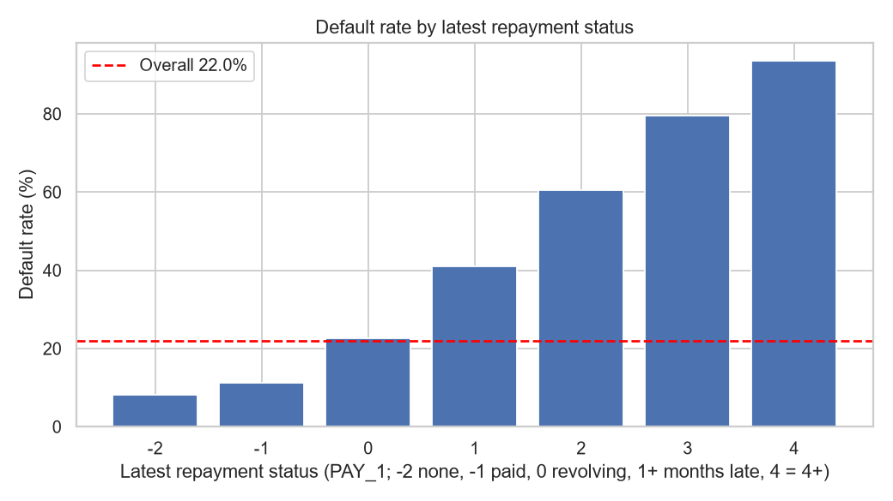
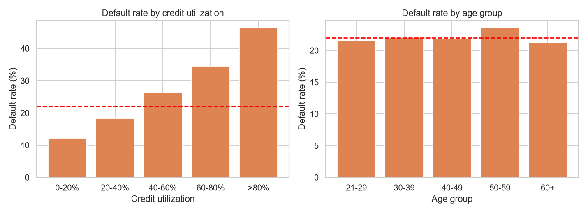
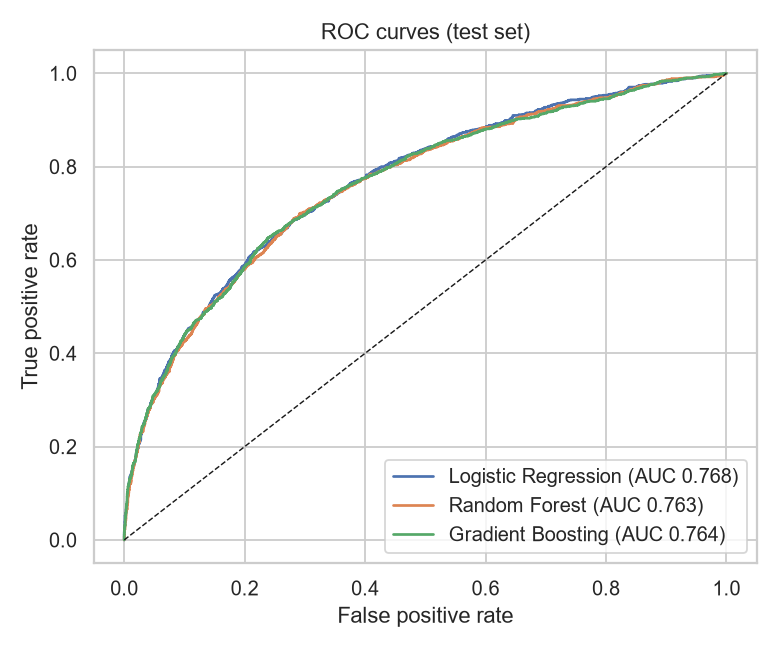
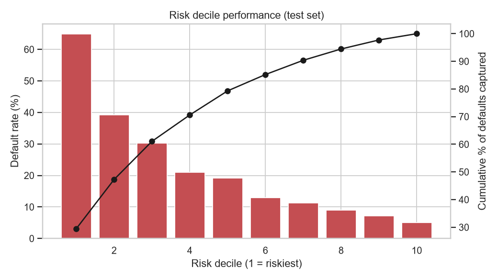
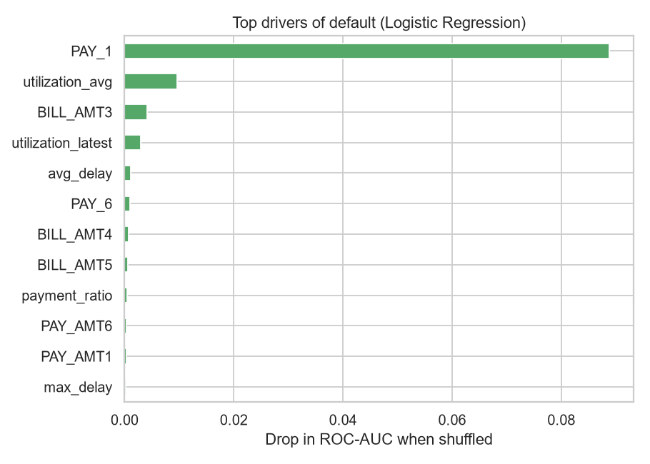
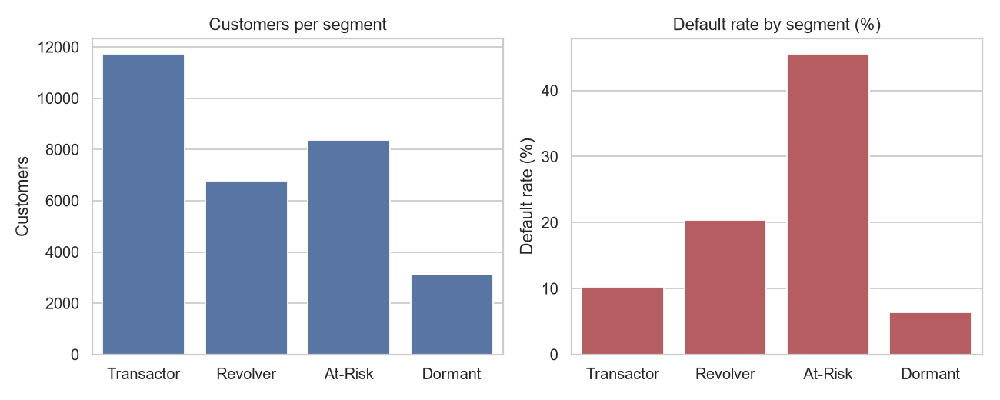

# Credit Risk & Spending Analytics: Loan Default and Credit Card Behavior

> **Data note:** this repo ships with a **synthetic** dataset that mirrors the schema of the UCI
> *Default of Credit Card Clients* data (30,000 customers, 6 months of history). The sandbox this was built in had no
> internet access. All numbers below come from the synthetic data and are for demonstration only.
> To get real findings, drop the real UCI CSV into `data/raw/credit_card_clients.csv` (see
> [Using the real dataset](#using-the-real-dataset)) and rerun the three commands in [How to run](#how-to-run).

## 1. Business problem
A retail bank sees rising credit card defaults and uneven card usage. As the data analyst I answer:
1. How big is the default problem and which segments drive it?
2. What are the strongest early signals of default?
3. Can a simple, explainable model rank customers by risk?
4. How do customers differ in spending and repayment behavior?
5. What should the bank do about it, and what is it worth?

## 2. Dataset
30,000 customers: credit limit, age, education, marital status, 6 months of repayment status (`PAY_1..6`),
bill amounts (`BILL_AMT1..6`), payment amounts (`PAY_AMT1..6`), and the target `default_flag`
(defaulted next month). Month 1 is the most recent month.

**Cleaning decisions** (logged by `src/pipeline.py`):
- Loaded 30,000 rows x 25 columns
- Missing values: 0; duplicate IDs: 0
- EDUCATION: 304 rows with undefined codes (0, 5, 6) merged into 'Other' (4)
- MARRIAGE: 73 rows with undefined code 0 merged into 'Other' (3)
- BILL_AMT: 530 customers have negative bills (credit balances/refunds); kept, but clipped at 0 when computing payment ratio

## 3. Tools
Python (pandas, scikit-learn, matplotlib, seaborn), SQL (SQLite; portable to PostgreSQL/MySQL), Power BI or Tableau for the dashboard.

## 4. Key findings
- **Overall default rate is 22.0%** (6,601 of 30,000 customers).
- **Repayment history is the strongest signal.** Customers with 0 delayed months out of 6 default at 11.2%,
  versus 68.8% for customers delayed in all 6 months (SQL Q5).
- **Utilization matters.** Default rate rises from 12.1% (0-20% utilization) to
  46.4% (above 80%) (SQL Q4).
- **Top model drivers** (permutation importance): `PAY_1`, `utilization_avg`, `BILL_AMT3`, `utilization_latest`.
- **Risk ranking works.** The riskiest 10% of customers default at 64.8% (3.0x average) and the
  top 3 deciles capture 61.1% of all defaults.
- **Segments differ sharply:** At-Risk customers default at 45.6% versus 10.2% for Transactors.




## 5. SQL analysis
`sql/analysis_queries.sql` answers 11 business questions using CTEs, window functions (`RANK`, `NTILE`, running `SUM() OVER`),
conditional aggregation, and a reusable view (`sql/schema.sql`). Result tables are saved in `outputs/sql_results/`.

| # | Question |
|---|---|
| Q1 | What is the overall default rate? |
| Q2 | Default rate by education and marital status |
| Q3 | Default rate by age group and credit-limit band (limit is the income proxy) |
| Q4 | Default rate by credit utilization band |
| Q5 | Do late payments in earlier months predict default? (number of delayed months out of 6) |
| Q6 | Six-month trend of average bill and payment, defaulters vs non-defaulters (month 6 = oldest) |
| Q7 | Average spend, utilization and repayment ratio: defaulters vs non-defaulters |
| Q8 | Top 3 highest-utilization customers within each age group (window function) |
| Q9 | Cumulative share of all defaults captured by risk decile (simple rule-based score) |
| Q10 | Early-warning rule: 2+ delayed months OR (delayed last month AND utilization > 80%) |
| Q11 | Is the repayment status getting worse? (latest month vs previous month) |

## 6. Feature engineering
`utilization_avg`, `utilization_latest` (bill / limit), `payment_ratio` (paid / billed), `avg_delay`, `max_delay`,
`months_delayed`, `bill_volatility` (std of bills / limit), plus age, limit and utilization bands.

## 7. Predictive model
Stratified 80/20 split. Class weights handle the 22/78 imbalance. `SEX` and `MARRIAGE` are **excluded** from the model
(fair-lending practice) and only past-behavior features are used (no target leakage).

| Model | ROC-AUC | KS | Precision | Recall | F1 |
|---|---|---|---|---|---|
| Logistic Regression | 0.768 | 0.405 | 0.423 | 0.648 | 0.512 |
| Gradient Boosting | 0.764 | 0.409 | 0.431 | 0.649 | 0.518 |
| Random Forest | 0.763 | 0.408 | 0.462 | 0.549 | 0.502 |



**Model choice:** Logistic Regression performs on par with the tree models (ROC-AUC 0.768, KS 0.405), so it is the
recommended model because it is simple and explainable to risk and compliance teams.

**Threshold chosen by business cost.** Assuming a missed default costs 5x a wrongly flagged good customer, the cost-minimizing
threshold is **0.4**: it catches 76.7% of defaulters with 36.2% precision, flags 46.6%
of customers, and lowers total cost by 4.9% versus the default 0.5 cutoff. Accuracy is not used because 78% accuracy is achievable by predicting
"no default" for everyone.

| Risk decile (1 = riskiest) | Default rate | Cumulative defaults captured | Lift |
|---|---|---|---|
| 1 | 64.8% | 29.5% | 2.95x |
| 2 | 39.2% | 47.3% | 1.78x |
| 3 | 30.3% | 61.1% | 1.38x |
| 4 | 21.0% | 70.6% | 0.95x |
| 5 | 19.2% | 79.3% | 0.87x |
| 6 | 13.0% | 85.2% | 0.59x |
| 7 | 11.3% | 90.4% | 0.52x |
| 8 | 9.0% | 94.5% | 0.41x |
| 9 | 7.2% | 97.7% | 0.33x |
| 10 | 5.0% | 100.0% | 0.23x |




## 8. Customer segmentation
Rule-based segments (explainable to business teams), cross-checked with K-Means (`outputs/kmeans_profiles.csv`):

| Segment | Customers | Share | Default rate | Avg utilization | Payment ratio |
|---|---|---|---|---|---|
| Transactor | 11,743 | 39.1% | 10.2% | 36% | 1.15 |
| Revolver | 6,782 | 22.6% | 20.4% | 40% | 0.56 |
| At-Risk | 8,368 | 27.9% | 45.6% | 47% | 0.16 |
| Dormant | 3,107 | 10.4% | 6.4% | 2% | 1.10 |

- **Transactors:** pay in full, low risk. Offer rewards and limit increases.
- **Revolvers:** carry balances, profitable but watch closely. Offer reminders and installment plans.
- **At-Risk:** 2+ delayed months. Trigger early collections outreach and restructuring offers.
- **Dormant:** almost no usage. Run reactivation campaigns.



## 9. Recommendations
1. **Deploy an early-warning rule:** flag customers with 2+ delayed months, or a delay last month with utilization above 80%.
   It flags 28.1% of the book, those customers default at 45.6% (2.1x average), and it catches
   58.1% of all defaulters (3,835 customers).
2. **Use the model score to prioritize collections:** work deciles 1-3 first (they hold 61% of defaults).
3. **Review limits** for customers with sustained utilization above 80% and a delay history.
4. **Grow healthy accounts:** target Transactors with rewards and selective limit increases.
5. **Estimated impact (assumption-based):** with an assumed loss given default of 60% and intervention success of
   25%, acting on the flagged defaulters avoids roughly **29.3M** in currency units
   (out of 327M exposure held by defaulters). Both assumptions are adjustable in `src/pipeline.py`.

## 10. Dashboard (Power BI / Tableau)
Import the files in `dashboard/`: `dashboard_customer_level.csv` (one row per customer with segment, risk score, decile, tier),
`dashboard_segments.csv`, `dashboard_risk_deciles.csv`.

| Page | Visuals |
|---|---|
| 1. Executive overview | KPI cards (customers, default rate, avg utilization, high-risk customers), default rate by age group / limit band, slicers |
| 2. Risk | Default rate by months delayed, utilization band vs default, risk tier distribution |
| 3. Spending behavior | Segment sizes, avg bill and payment ratio by segment, segment default rate |
| 4. Model | Decile table, cumulative capture (gains) chart, top-risk customer list |

Starter DAX measures:
```
Customers = COUNTROWS(dashboard_customer_level)
Default Rate = DIVIDE(SUM(dashboard_customer_level[default_flag]), [Customers])
High Risk Customers = CALCULATE([Customers], dashboard_customer_level[risk_tier] = "High")
Avg Utilization = AVERAGE(dashboard_customer_level[utilization_avg])
High Risk Default Rate = CALCULATE([Default Rate], dashboard_customer_level[risk_tier] = "High")
```
A `.pbix` file cannot be generated outside Power BI Desktop, so the dashboard itself must be built from these files.

## 11. How to run
```bash
pip install -r requirements.txt
python src/generate_data.py   # skip if you use the real dataset
python src/pipeline.py        # cleaning, SQL, EDA, model, segments, exports
python src/build_dashboard.py # builds dashboard/credit_risk_dashboard.html
python src/build_readme.py    # regenerates this README with the latest numbers
pytest -q                     # smoke tests (or: make all)
```

## 12. Deploy with GitHub Actions
`.github/workflows/pipeline.yml` runs on every push to `main`, on pull requests, and on demand. It installs dependencies, runs the
pipeline, rebuilds the README and dashboard, runs `pytest`, uploads the results as a downloadable artifact, and (on `main`) publishes the
dashboard to **GitHub Pages**.

One-time setup: push the repo to GitHub, then go to **Settings > Pages > Build and deployment > Source** and choose **GitHub Actions**.
The dashboard will be live at `https://<your-username>.github.io/<repo-name>/`. Run history is under the **Actions** tab.

## 13. Using the real dataset
1. Download *Default of Credit Card Clients* (UCI or Kaggle).
2. Rename columns: `PAY_0` to `PAY_1`, `default payment next month` to `default_payment_next_month`.
3. Save as `data/raw/credit_card_clients.csv`, then rerun the commands above.

## 14. Repo structure
```
data/raw, data/processed   input and cleaned data
sql/                       schema.sql (view), analysis_queries.sql (11 queries)
src/                       generate_data.py, pipeline.py, build_dashboard.py, build_readme.py
tests/                     pytest smoke tests
.github/workflows/         CI/CD pipeline (run + test + deploy to GitHub Pages)
outputs/                   model comparison, deciles, segments, SQL result CSVs, results.json
reports/figures/           9 charts
dashboard/                 BI-ready CSV files
```

## 15. Limitations and future work
- Synthetic demo data; real findings need the real file. Historical snapshot, no macroeconomic data.
- Single random split; use time-based validation and cross-validation on real data.
- Add SHAP explanations, probability calibration, and a fairness audit across age and gender.
- Replace assumed LGD and intervention success with the bank's own figures.

## 16. Resume bullets (replace numbers after running on real data)
- Analyzed 30,000 credit card accounts with SQL and Python, identifying repayment delays and utilization as the top default drivers.
- Built an explainable credit risk model (ROC-AUC 0.77, KS 0.41) whose top 3 risk deciles capture 61% of defaults.
- Designed an early-warning rule and customer segmentation that isolate a 28% high-risk slice defaulting at 2.1x the average rate.
- Delivered a 4-page Power BI dashboard on default rate, risk segments, and spending behavior.
